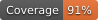

# Repository Coverage

[Full report](https://htmlpreview.github.io/?https://github.com/spdx/pyjsign/blob/python-coverage-comment-action-data/htmlcov/index.html)

| Name                               |    Stmts |     Miss |   Branch |   BrPart |   Cover |   Missing |
|----------------------------------- | -------: | -------: | -------: | -------: | ------: | --------: |
| src/pyjsign/\_\_init\_\_.py        |       10 |        0 |        0 |        0 |    100% |           |
| src/pyjsign/\_\_main\_\_.py        |        3 |        0 |        0 |        0 |    100% |           |
| src/pyjsign/algorithm\_registry.py |       36 |        0 |        2 |        0 |    100% |           |
| src/pyjsign/base64url.py           |        8 |        0 |        2 |        0 |    100% |           |
| src/pyjsign/canonicalization.py    |       12 |        5 |        0 |        0 |     58% | 45-48, 61 |
| src/pyjsign/certificate.py         |       28 |        3 |        8 |        1 |     89% | 42-43, 72 |
| src/pyjsign/cli.py                 |      408 |       45 |      128 |        8 |     88% |57, 66-67, 86-87, 108-109, 280->282, 294-296, 380, 427-430, 468-473, 480-489, 494-496, 502-509, 532-542, 553-555, 1205 |
| src/pyjsign/jsf.py                 |      469 |       22 |      198 |       14 |     95% |156, 216, 526, 565, 964, 968, 1077, 1081, 1131, 1149-1151, 1185, 1252-1253, 1260, 1271, 1279-1280, 1303-1304, 1317 |
| src/pyjsign/jss.py                 |      220 |       18 |       82 |       12 |     90% |86-87, 94-95, 116, 159, 177, 198, 307, 323, 339, 380, 391, 461, 477, 495-496, 599 |
| src/pyjsign/jwk\_handler.py        |       21 |        1 |        8 |        1 |     93% |        73 |
| src/pyjsign/signer.py              |        4 |        0 |        0 |        0 |    100% |           |
| src/pyjsign/vault\_signer.py       |       59 |        0 |       12 |        0 |    100% |           |
| src/pyjsign/version.py             |        1 |        0 |        0 |        0 |    100% |           |
|                          **TOTAL** | **1279** |   **94** |  **440** |   **36** | **92%** |           |

## Setup coverage badge

Below are examples of the badges you can use in your main branch `README` file.

### Direct image

This is the one to use if your repository is private or if you don't want to customize anything.

### [Shields.io](https://shields.io) Json Endpoint

Using this one will allow you to [customize](https://shields.io/endpoint) the look of your badge.
It won't work with private repositories. It won't be refreshed more than once per five minutes.

### [Shields.io](https://shields.io) Dynamic Badge

This one will always be the same color. It won't work for private repos. I'm not even sure why we included it.

## What is that?

This branch is part of the
[python-coverage-comment-action](https://github.com/marketplace/actions/python-coverage-comment)
GitHub Action. All the files in this branch are automatically generated and may be
overwritten at any moment.